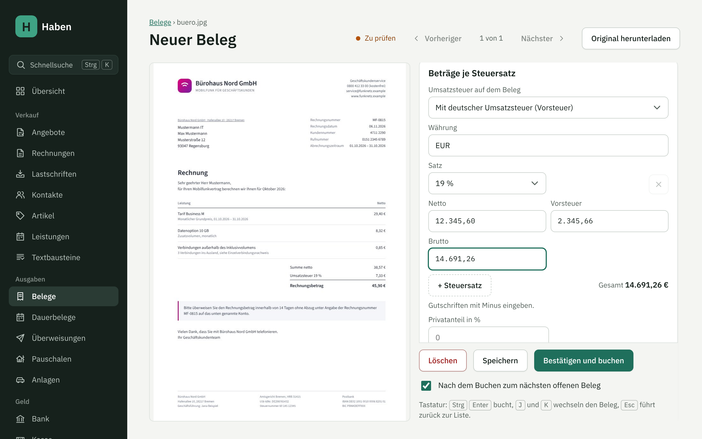
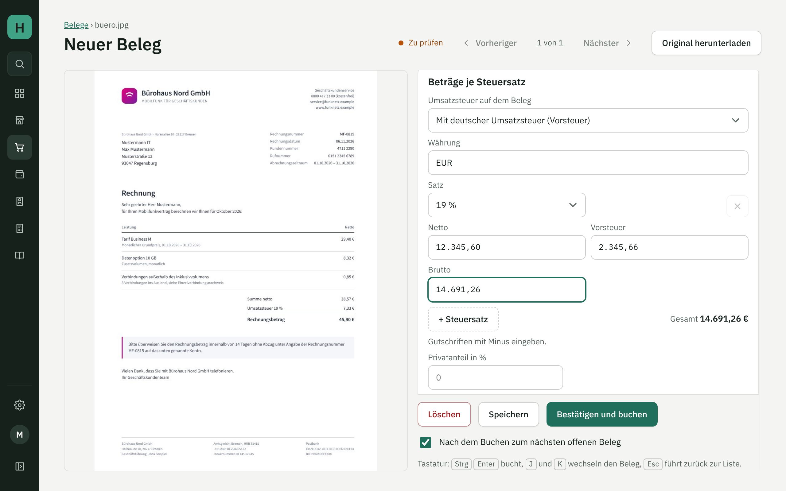
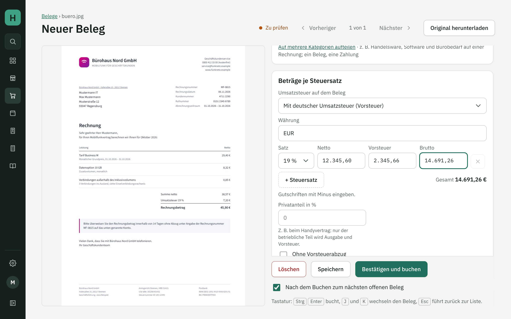
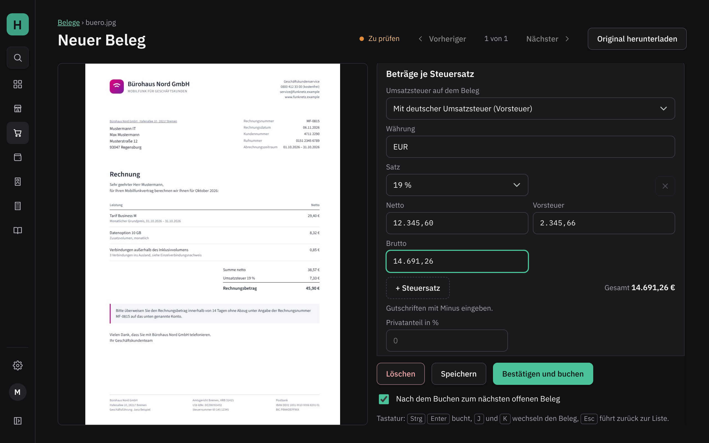
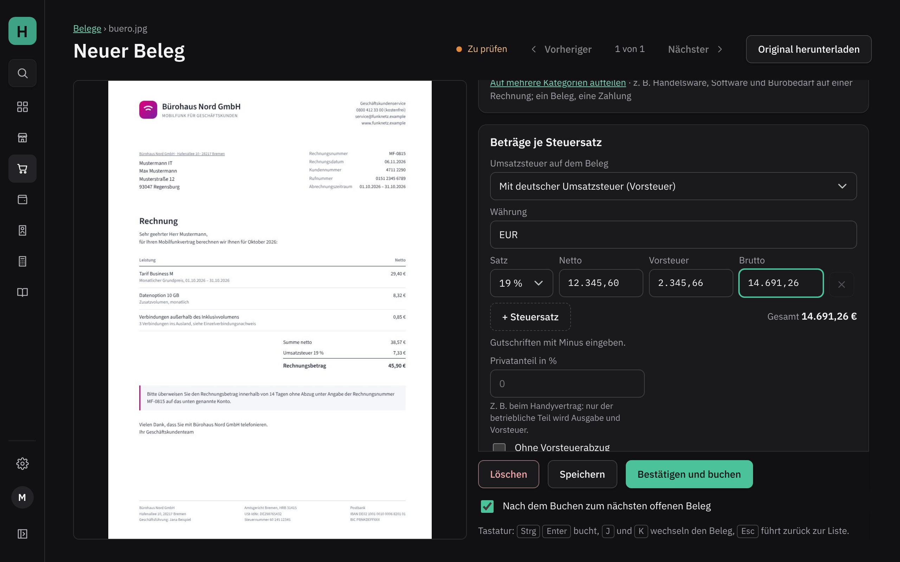
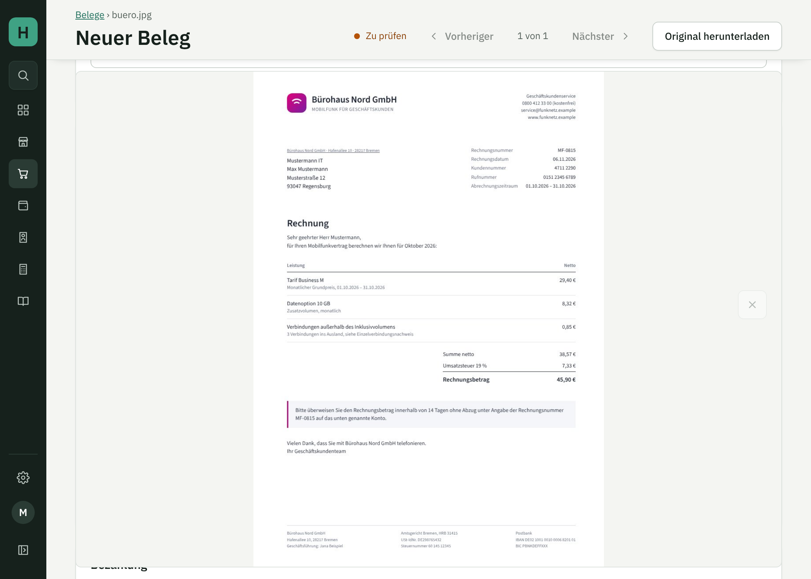
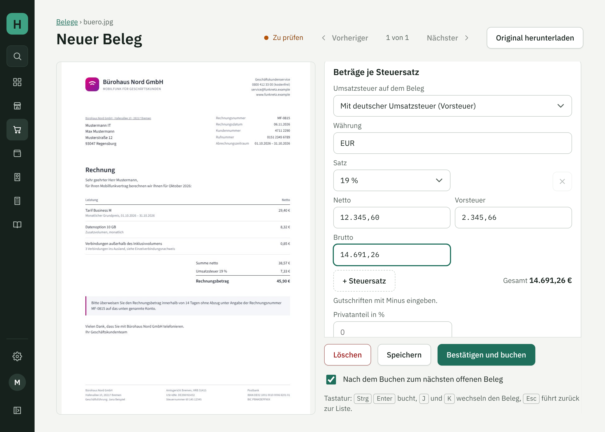

# firsttris/haben#1118: Formular und Beleg nach der Breite der Arbeitsfläche

„Beleg prüfen“, Fenster 1280 bzw. 1120 px, Seitenleiste aus- oder eingeklappt.

| | Vorher | Nachher |
| --- | --- | --- |
| 1280 px, ausgeklappt, hell (unverändert) |  |  |
| 1280 px, eingeklappt, hell |  |  |
| 1280 px, eingeklappt, dunkel |  |  |
| 1120 px, eingeklappt, hell (vorher deckt der Beleg das Formular zu) |  |  |
